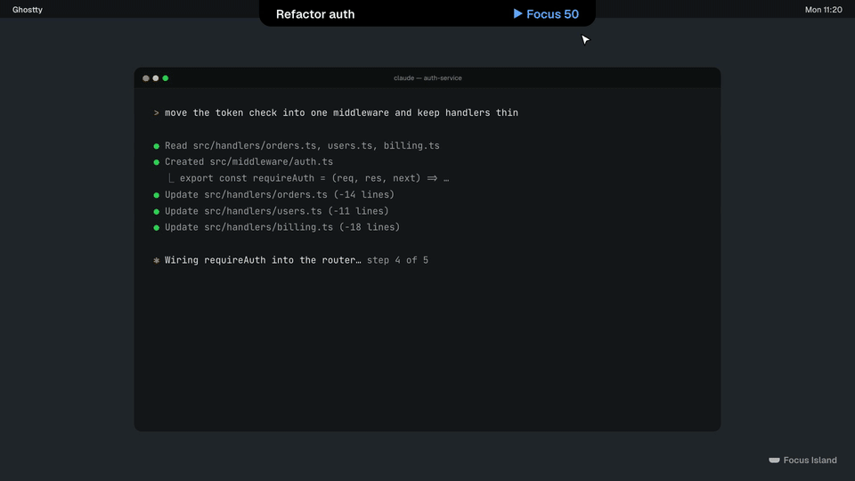

# Focus Island

[](docs/media/focus-island-demo.mp4)

**Focus Island** is a macOS tool that turns the time you spend waiting on Claude Code into something useful. While Claude works on a task, the app suggests your next step: a new task from a simple kanban board, a session that is waiting for you, or a nudge to get back to work if you drifted off to social media.

> [!NOTE]
> The Focus Island interface is currently in Russian. UI labels quoted below are English translations.

## Installation

1. Download `Focus.Island.dmg` from the [Releases](https://github.com/dias-zhanabayev/focus-island/releases) page — one file for both Apple Silicon and Intel.
2. Open the DMG and drag **Focus Island** into Applications.
3. On first launch, right-click the app → Open.
4. In the island under the notch, click "Connect" — Focus Island will add the Claude Code hooks.

> [!NOTE]
> The build is signed with a local certificate and is not notarized by Apple, so macOS asks you to confirm the first launch. If "Open" does not appear: System Settings → Privacy & Security → Open Anyway.

## Features

**Start of day and binding sessions to tasks**
- "Start of day" — a morning card: what was left open yesterday, last night's note, and a pick of 1–3 tasks for today.
- A new Claude Code session offers to bind itself to a task (from this project or others), create a task from the first prompt, or skip.

**Focus timer**
- "Pick a task · Todo N" in the closed island and a "What are you working on now?" card; starting a task (dragging it to In progress or clicking "Start") opens the "Start task" sheet.
- The sheet binds open sessions (same project first) and optionally starts a pomodoro: 25 min, 50 min or a custom length (5–120), followed by a break.
- The timer lives in the island's left ear and in the panel header, with pause and stop; the task card shows the same timer and "+ Add session".
- Defaults are 50 minutes of focus and 10 of rest (Settings → Focus → "Focus timer"); for a one-off change use "Timer 50 min ▾" in the panel (25/50/90/custom) and the break-length menu on the "Pomodoro done" card.
- End of focus: a sound and a 5-second countdown, then the break starts on its own (5/10/15/20 min, can be cancelled or started right away; can be turned off in settings); the interval's KPIs and the next step go into the task note. After the break — "▶ Start focus · N min"; focus never starts by itself.
- When a session has done its part — "✓ Done": it stays in the task (time, summary) but moves to the collapsed "Done" group and stays quiet; "Undo" or a new prompt brings it back. "Unbind" and "Move to another task" are in the "⋯" menu.
- When Claude finishes, the island shows a short summary (for Claude.app sessions — Claude's own turn summary, for terminal sessions — the first sentence of the reply); the full reply is behind "Full reply ▾".
- Without a task, the island only offers to pick one; a new session does not pop the island open — there is a hint in the pill, and during focus a quiet "Into this task / ✕" line at the bottom of the panel.
- The number of pomodoros per day appears in the "Today" summary.
- "Take" on the pick card brings a task from "In progress" into focus; if it has no sessions, the "Task sessions" screen opens right away with checkboxes (bound sessions first, then the project's sessions). While a task is in focus, the panel shows only its sessions: "Unbind", "+ Add session", "Timer", "✓ Close task" (goes straight to Done, with an 8-second "Undo").

**While Claude is working**
- Every session is labelled with its task and Claude's current plan step (from TodoWrite): "Step k of n", progress and a time estimate.
- "What's next?" — stay in the task: queue the next prompt, review changed files (git diff), tick off the definition of done; or, as a second option, switch to a waiting session or another task.
- Prompt queue: when Claude finishes, "Send and go back" pastes the prompt into the session's terminal and takes you there. Sending works in Ghostty, iTerm2, Terminal.app and tmux; in other terminals the prompt is copied to the clipboard (⌘V).
- Distraction nudge: if you wander off to Telegram, YouTube and the like, the island reminds you to go back to the terminal (snooze for 5 minutes or "I need this").
- Coming back: when Claude is done, the card shows what was done, the definition of done and the queued prompt.

**Multiple sessions**
- Session panel: "Waiting for you", "Done, review", "Working", "No task", "Paused".
- Overload: when you run more sessions than your limit, the island suggests answering a waiting one first or pausing a working one.
- Waiting sessions from other tasks: the "Waiting outside task · N" button in the panel expands a list (age, which session, "Open", "⋯" — add to the current task or snooze); they never pop the island open on their own, there is just a quiet "N waiting" counter on the left of the pill.
- Re-entry: when you switch to another task, you get a short "where you left off" and "what Claude did" summary.
- Collapsed island ears: a summary on the left (working, waiting, done), the task in focus on the right; an orange "waiting Nm" when something has been waiting a long time.

**Board and task card** (⌥⌘B)
- Kanban Backlog → Todo → In progress → Done with drag & drop; badges for progress, definition of done and "prompt queued".
- Task card: description, definition of done, "Where you left off", queued prompt, all task sessions with "Open" / "Resume" / "Unbind", "+ Add session" (same picker screen), "Close task".

**Reports**
- "Today" — a daily summary: "You were working", "Claude was working", "Sessions waited for you", distractions, a time strip by task, "Done", "Still open", "Start tomorrow with"; "Copy to note" puts a markdown summary on the clipboard.
- "Week" — tasks, sessions, distractions, hours per day and "Where the time went".
- "History" — a searchable session archive; "Open" jumps to a live session and "Resume" continues one via `claude --resume`.

**Settings** (Settings → Focus)
- Claude Code hook status and path, install and uninstall.
- "Sessions": parallel session limit (1–6), waiting-session reminder (5–60 min), the "Start of day" morning screen.
- "What's next?", "Distractions" (threshold, blocklist of domains and apps), terminal used for Resume, board hotkey.

## Releasing

```bash
zsh scripts/release.sh 0.2.0
```

Requirements: a clean `main` that matches `origin/main`, release notes in `docs/releases/v0.2.0.md` (the first line is the release title) and the certificate from `zsh scripts/setup-dev-signing.sh`. The script runs the tests, builds a universal signed DMG and ZIP, tags `v0.2.0` and publishes the GitHub Release.

## Building and running the dev version

```bash
zsh scripts/launch-dev-app.sh
```

Claude Code integration hooks are installed from Settings → Setup. Installing the hooks modifies `~/.claude/settings.json`.

App data is stored in `~/Library/Application Support/FocusIsland/`.

Checks: `zsh scripts/harness.sh ci`, tests: `zsh scripts/test-clt.sh`.

## About

Focus Island is a fork of [open-vibe-island](https://github.com/Octane0411/open-vibe-island) (GPL v3), adapted specifically for Claude Code. It was built as a personal productivity tool for working with Claude Code in the terminal on macOS 14+.

## Supported terminals

Terminal.app, iTerm2, Ghostty, tmux, Zellij, WezTerm, Warp, cmux, VS Code, Cursor, Windsurf, Trae, Qoder, CodeBuddy, JetBrains IDEs (jump-to-terminal for Claude Code sessions).

## Requirements

macOS 14+, Swift 6.2 toolchain / Command Line Tools. Run the tests with `zsh scripts/test-clt.sh`.

---

## License

[GPL v3](LICENSE)
