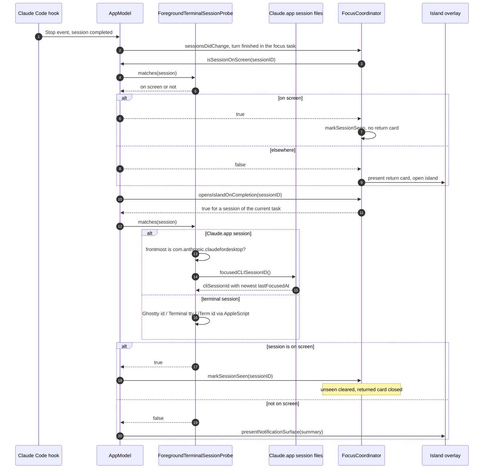

# Focus Island answer already on screen — sequence diagram

Covers P26: the completion summary and the Focus Island return card are skipped when the finished session is the one open in front of the user. Derived from `AppModel.scheduleNotificationSurfacePresentationIfNeeded`, `FocusCoordinator.presentReturnedUnlessOnScreen`, `ForegroundTerminalSessionProbe.matches(session:)` and `ClaudeDesktopSessionLocator.focusedCLISessionID`.

