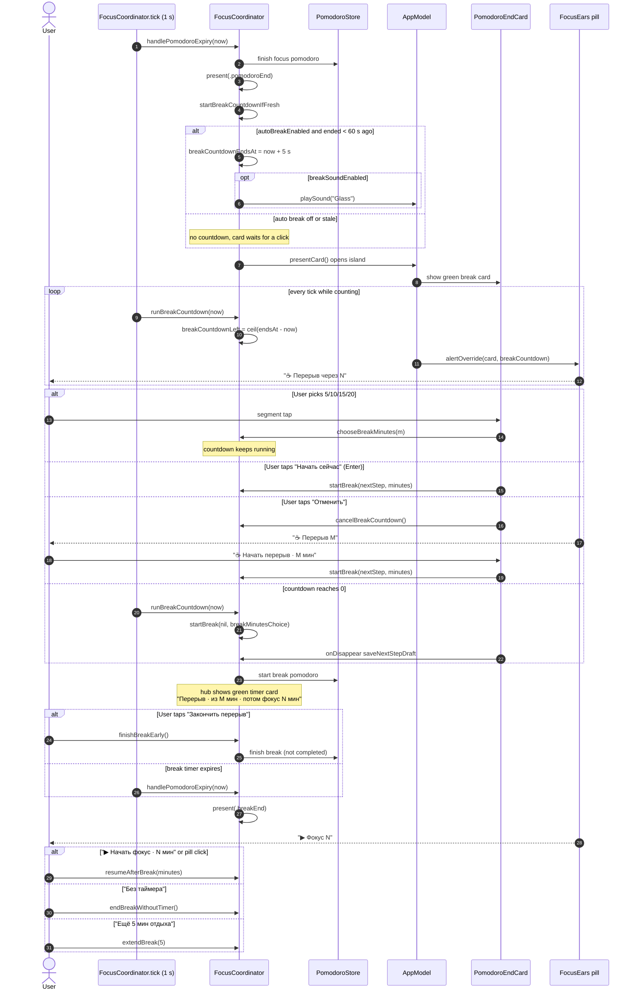

# Focus Island auto break — sequence diagram

Covers the end of a focus interval through the auto-started break and the break-end card (spec addendum P19). Derived from `FocusCoordinator.tick`, `startBreakCountdownIfFresh`, `runBreakCountdown`, `finishBreakEarly`, `PomodoroEndCard` and `FocusEars.alertOverride`.

