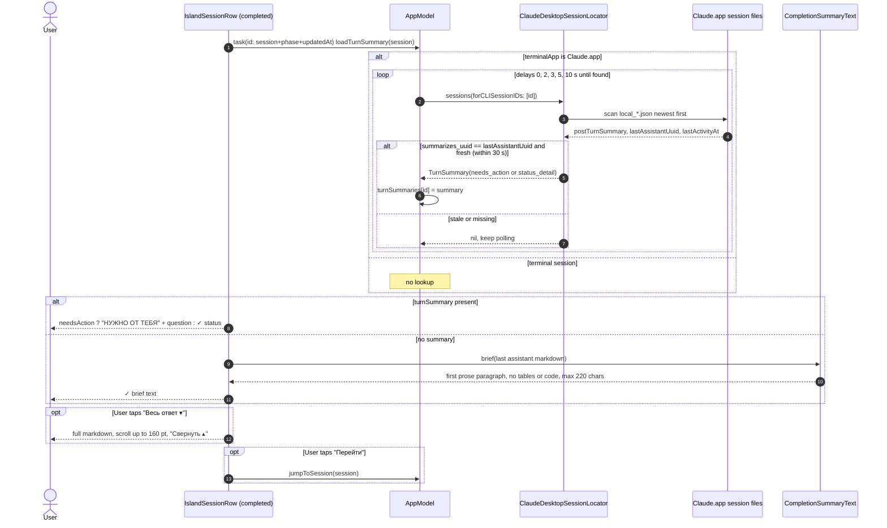

# Focus Island completion summary — sequence diagram

Covers how the "Claude finished" card picks its one-line summary (spec addendum P21). Derived from `IslandPanelView` (`completionActionBody`, `.task` on the card), `AppModel.loadTurnSummary`, `ClaudeDesktopSessionLocator.turnSummary` and `CompletionSummaryText.brief`.

