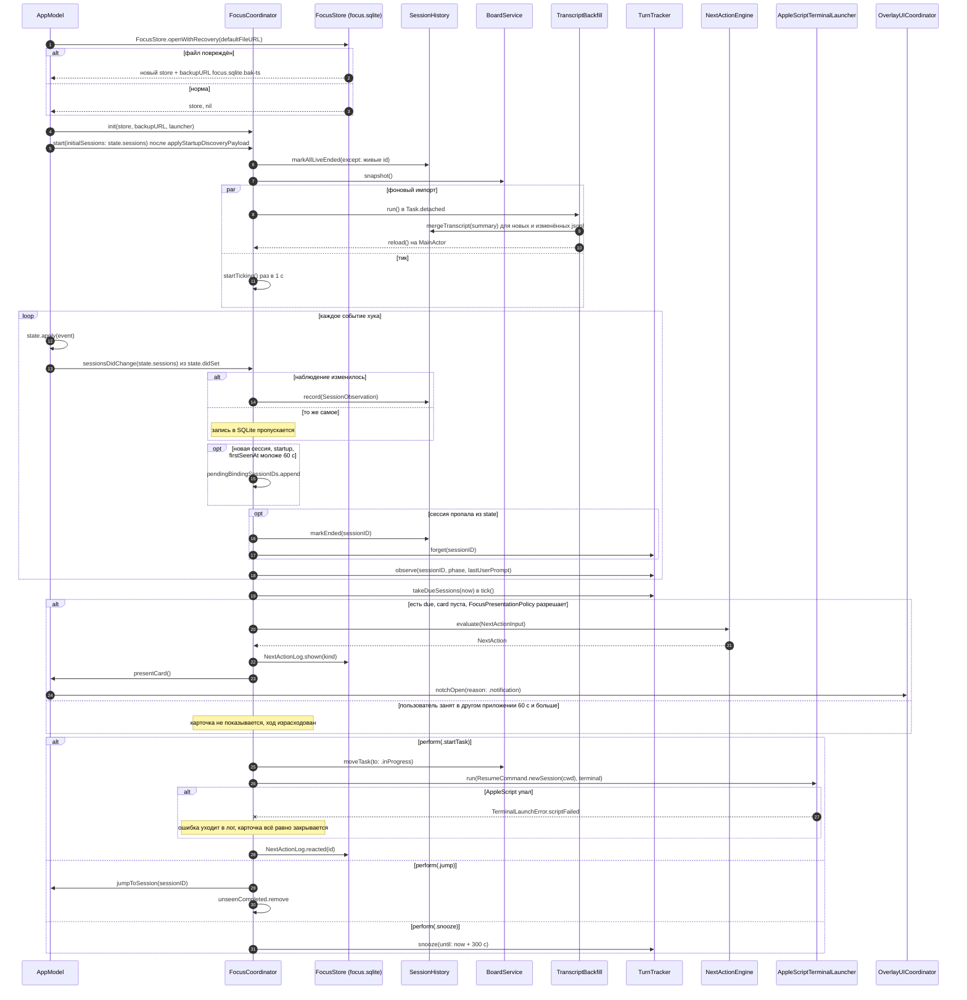

# Focus Island: связь FocusCoordinator с AppModel — sequence-диаграмма

Показывает, как реализация из плана `docs/superpowers/plans/2026-10-09-focus-island.md` (Tasks 13–17) встраивается в код апстрима: старт и backfill, обработка `state.didSet`, тик подсказки «Что дальше?», действия пользователя и ветки ошибок. Имена методов взяты из плана и из `AppModel.swift` апстрима.

