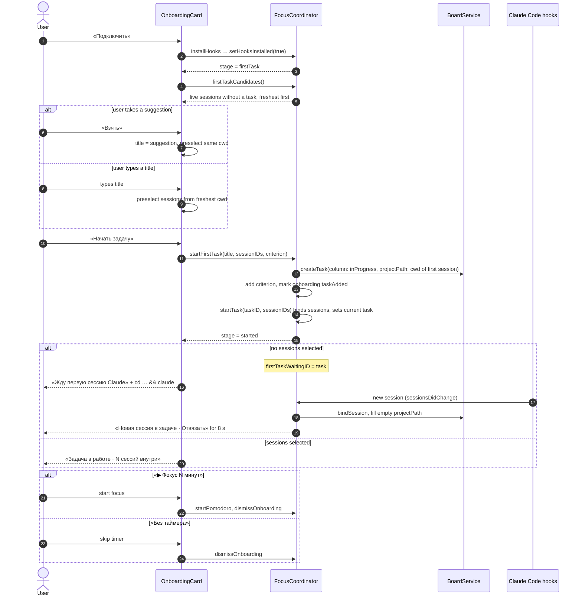

# Focus Island first task onboarding — sequence diagram

Covers P24: from connecting Claude Code to a task in progress, including the task that waits for its first session. Derived from `OnboardingCard` and `FocusCoordinator.startFirstTask` / `autoBindToWaitingTask`.

