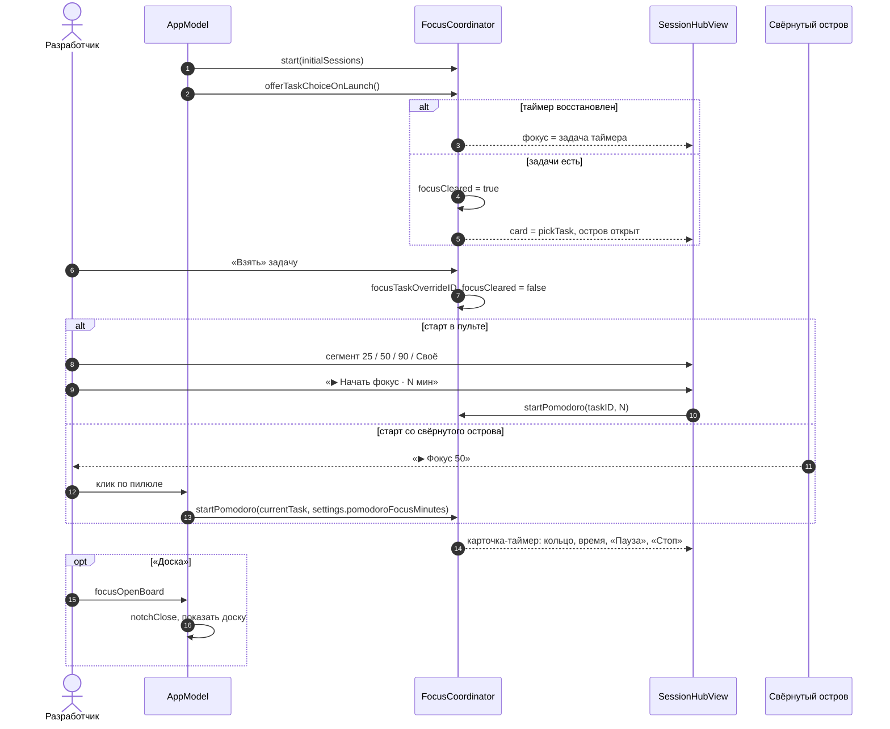

# Focus Island — включить фокус — sequence diagram

P16 из `docs/superpowers/specs/2026-10-10-focus-island-pomodoro-design.md`: выбор задачи при запуске, старт фокуса из пульта и из свёрнутого острова.

