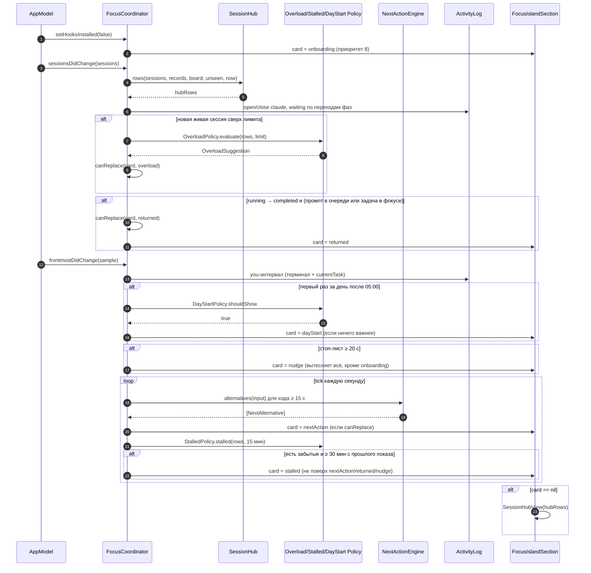

# Focus Island v3 — выбор карточки координатором — sequence diagram

Как после плана `docs/superpowers/plans/2026-10-10-focus-island-journey.md` (Task 5–8) входы координатора превращаются в одну карточку island по приоритету `FocusCard.canReplace`.

