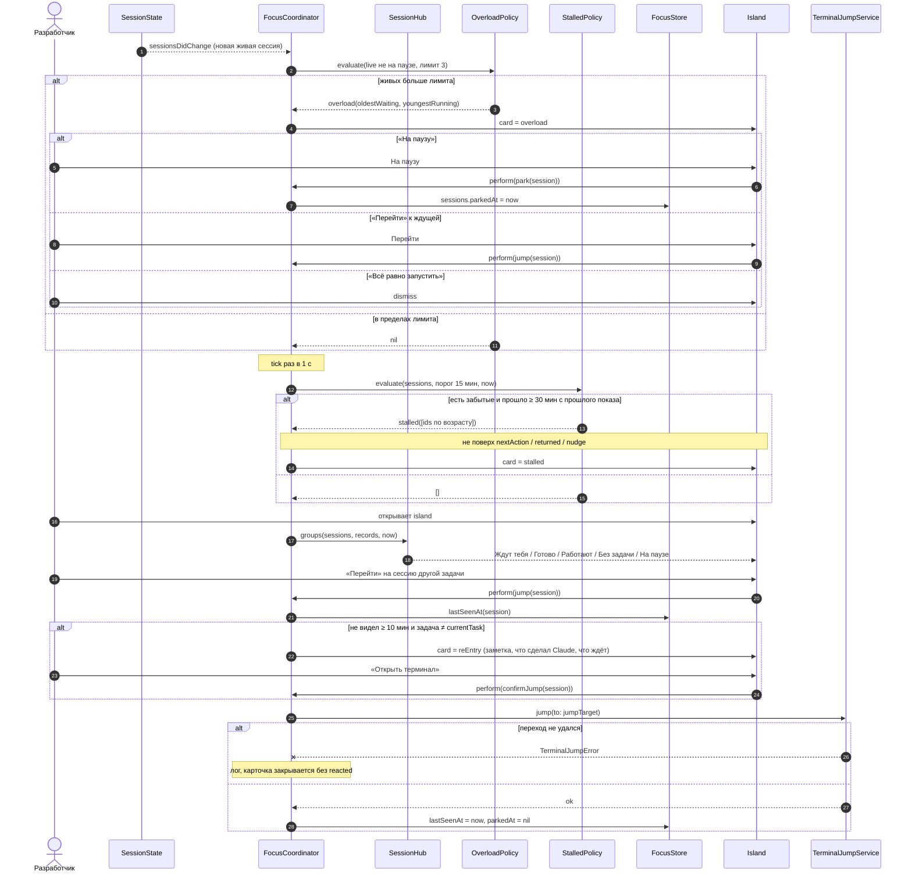

# Focus Island — несколько сессий — sequence diagram

Перегрузка, вход в другую задачу и забытые сессии (спека v3, J5, J8, J9, J11). Политики — чистые функции FocusCore, координатор только выбирает карточку по приоритету.

