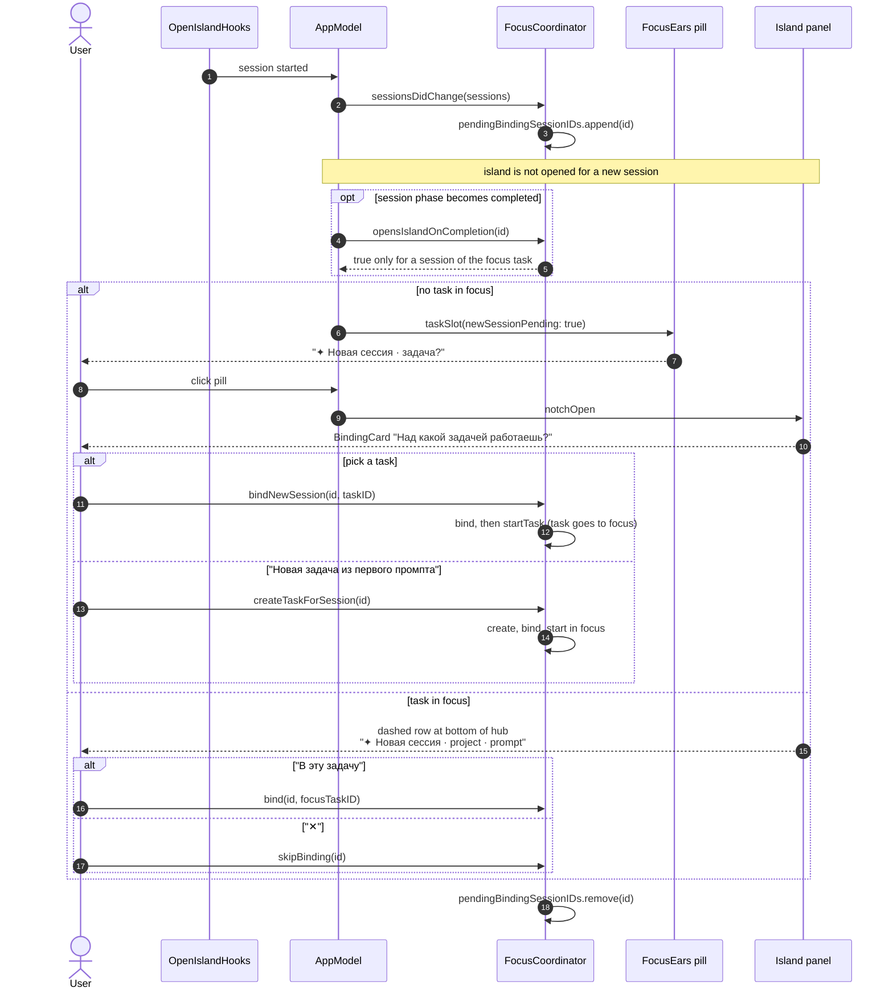

# Focus Island new session — sequence diagram

Covers a new Claude Code session appearing with and without a task in focus (spec addenda P18 and P20). Derived from `FocusCoordinator.sessionsDidChange`, `bindNewSession`, `skipBinding`, `opensIslandOnCompletion`, `AppModel.scheduleNotificationSurfacePresentationIfNeeded` and `SessionHubView.newSessionHint`.

