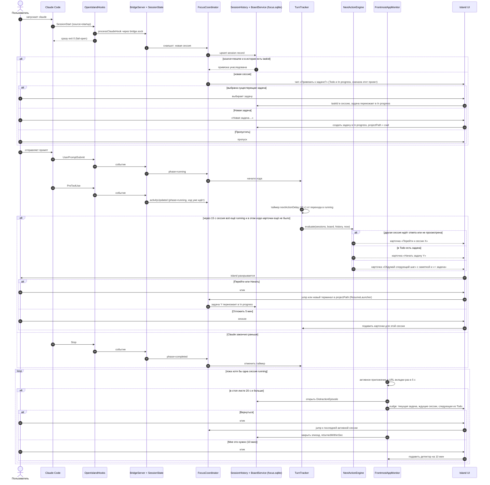

# Focus Island: подсказка «Что дальше?» — sequence-диаграмма

Покрывает жизненный цикл одного хода Claude: привязка сессии к задаче на канбан-доске, срабатывание «Что дальше?» и детектор отвлечения. Построена по разделам F4–F6 и 7.4 файла `docs/superpowers/specs/2026-10-09-focus-island-pdr.md` (ревизия 2) и по цепочке апстрима: хук → `bridge.sock` → `BridgeServer` → `SessionState`.

