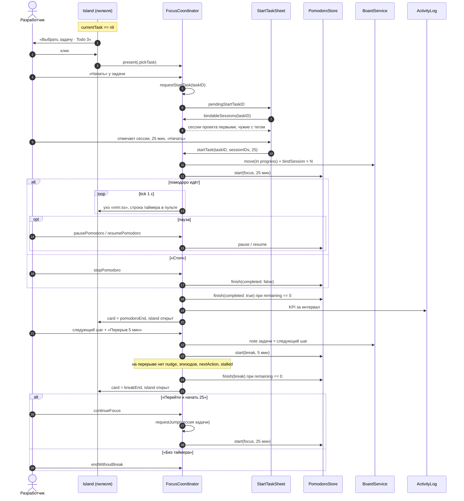

# Focus Island — старт задачи и помодоро — sequence diagram

Путь 7.0–7.5 из `docs/superpowers/specs/2026-10-10-focus-island-pomodoro-design.md`: выбор задачи, привязка открытых сессий, фокус, конец помодоро, перерыв и возврат.

