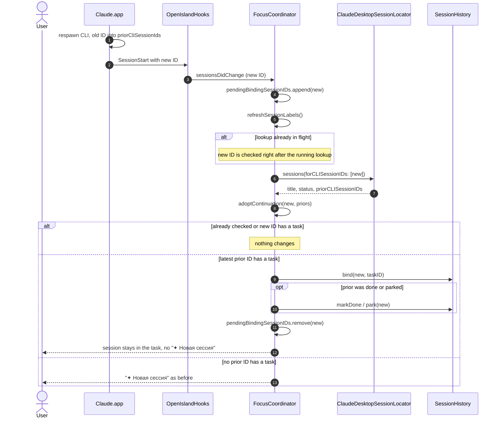

# Focus Island session continuation — sequence diagram

Covers a Claude.app session that comes back with a new Claude Code session ID (spec addendum P23). Derived from `FocusCoordinator.sessionsDidChange`, `refreshSessionLabels`, `adoptContinuation` and `ClaudeDesktopSessionLocator.sessions(forCLISessionIDs:)`.

