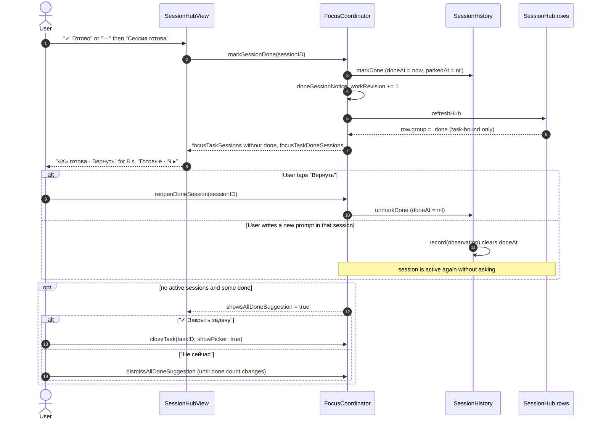

# Focus Island session done — sequence diagram

Covers marking a task session as done, returning it, and the all-done suggestion (spec addendum P22). Derived from `FocusCoordinator.markSessionDone`, `reopenDoneSession`, `showsAllDoneSuggestion`, `SessionHistory.markDone` / `record`, `SessionHub.row` and `SessionHubView.focusBlock`.

