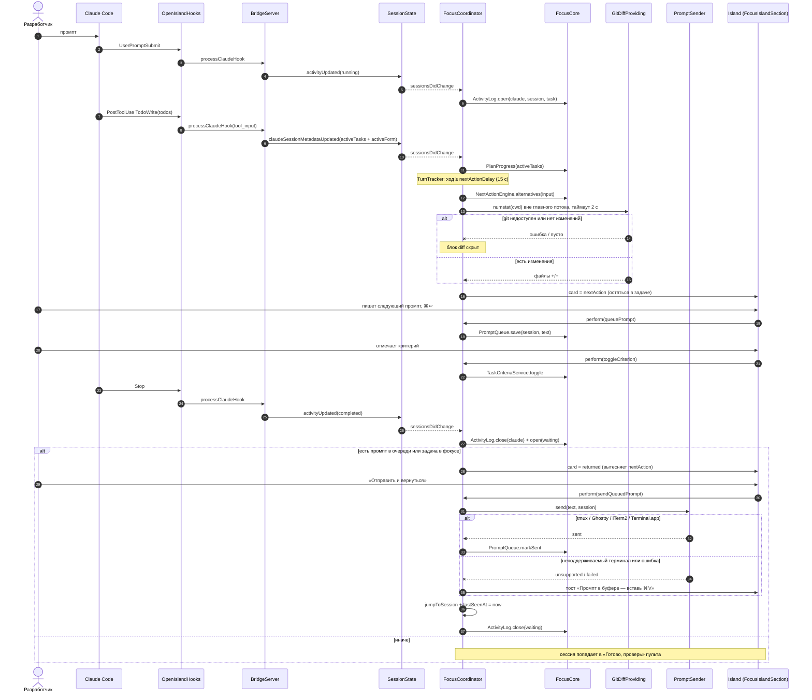

# Focus Island — остаться в задаче и вернуться — sequence diagram

Ход Claude от промпта до возврата с промптом из очереди (спека v3, J1, J2, J4, J6, J16). Имена — реальные типы апстрима и новые модули из `docs/superpowers/specs/2026-10-10-focus-island-journey-design.md`.

