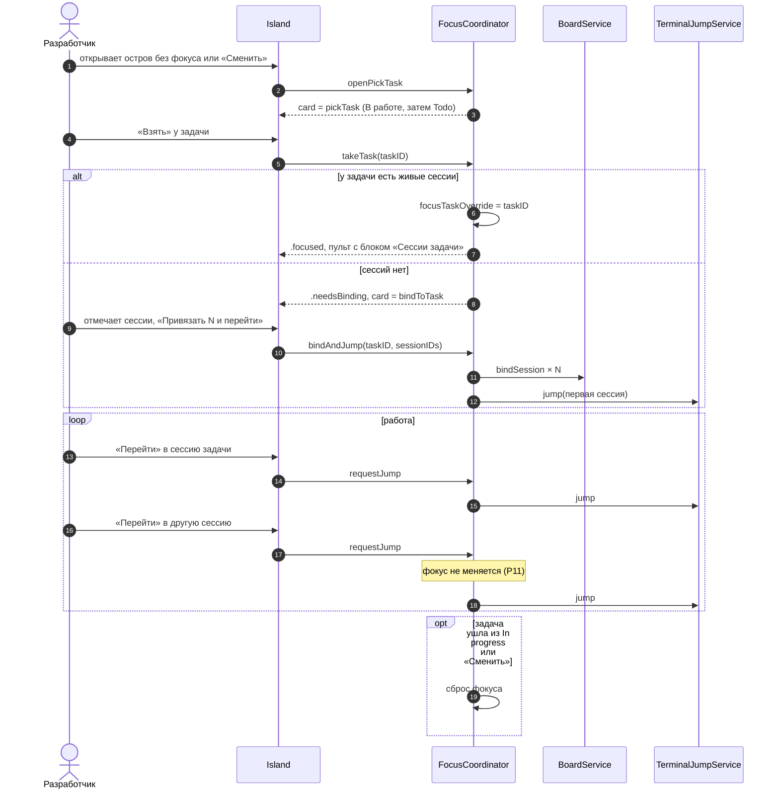

# Focus Island — взять задачу и работать в её сессиях — sequence diagram

Дополнение P9–P11 к `docs/superpowers/specs/2026-10-10-focus-island-pomodoro-design.md`: выбор из «В работе», привязка сессий в острове, пульт задачи и стабильный фокус.

