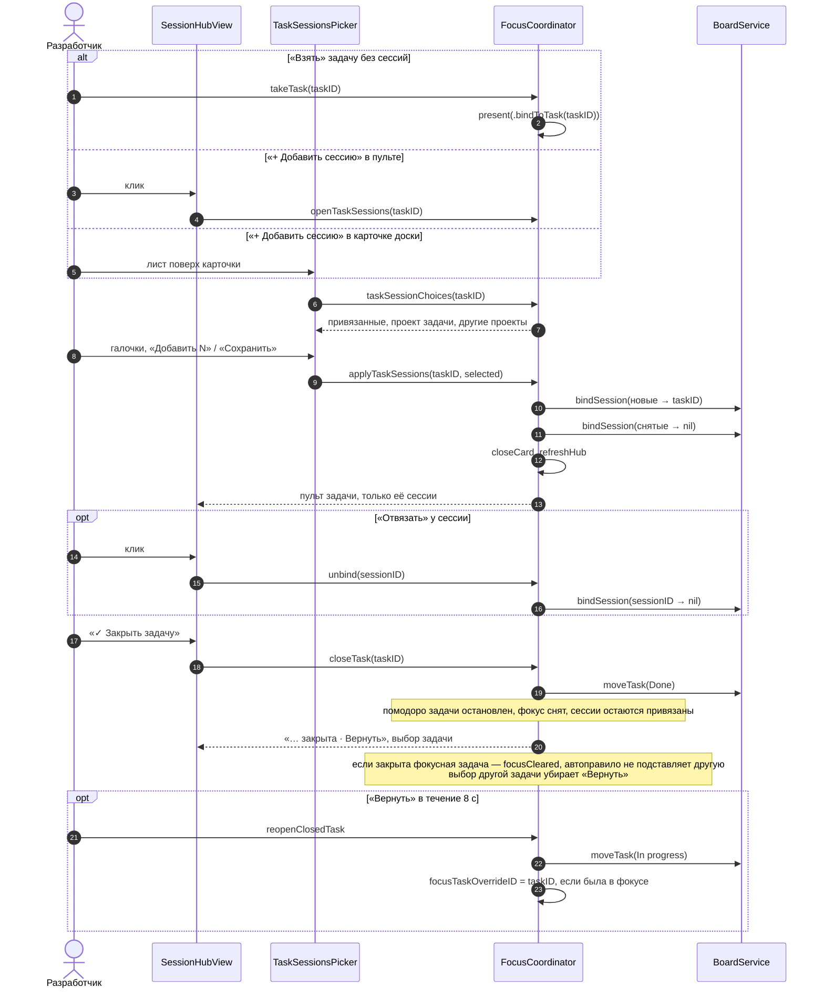

# Focus Island — сессии задачи и закрытие — sequence diagram

P12–P14 из `docs/superpowers/specs/2026-10-10-focus-island-pomodoro-design.md`: один экран выбора сессий из пульта, «Взять» и доски, «Отвязать» и «Закрыть задачу».

