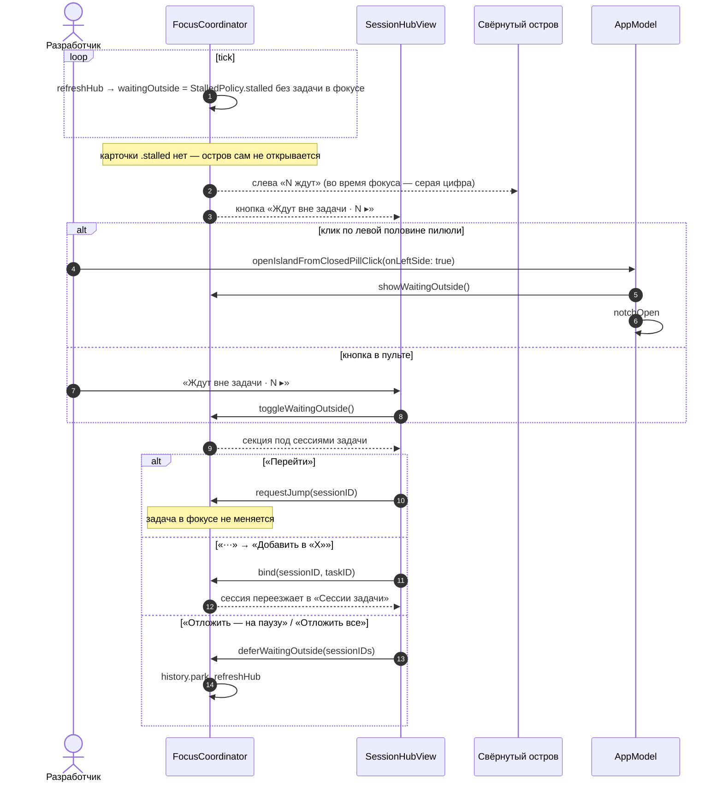

# Focus Island — ждут вне задачи — sequence diagram

P17 из `docs/superpowers/specs/2026-10-10-focus-island-pomodoro-design.md`: ждущие сессии других задач без карточки-перехвата, кнопка и секция в пульте, счётчик в пилюле.

